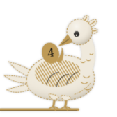
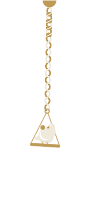

# Remi for Mac

**A little bird that remembers for you.**

Remi lives on the edge of your screen and holds what you meant to do: tasks, notes and links, one click or one shortcut away. It is a native macOS app, and everything stays on your Mac.

<p>
  
  
  
</p>

Remi is inspired by Sankofa, the Adinkra symbol of a bird looking back at the egg on its back: it is not wrong to go back for what you have forgotten. Choose **Perched** (on a gold peg at the side of the screen) or **On the cord** (on a swing at the end of a knotted cord, one knot per task due today), in one of four plumages.

## Install

Remi needs macOS 26 or later. It is not notarized, because that needs a paid Apple Developer account.

### From source

You need Xcode and [XcodeGen](https://github.com/yonaskolb/XcodeGen) (`brew install xcodegen`). No Apple account is needed.

```
git clone https://github.com/sharrygold/remi.git
cd remi
Scripts/install.sh
```

The script builds a Release copy, closes any running one, puts it in `/Applications` and opens it. Run it again to update.

### From a release zip

1. Download the zip from the Releases page, unzip it and move **Remi.app** to Applications.
2. Open it. macOS will say it can't check the app and block it.
3. Open **System Settings > Privacy & Security**, scroll down and click **Open Anyway** next to Remi, then confirm. (Control-click > Open no longer gets past this on macOS 15 and later.)

## First run

A welcome card shows the shortcut, how to type a task, and lets you pick a companion and turn on **Open at login**. You can see it again from **Settings > General**.

macOS asks for two permissions, each only when it's needed:

- **Notifications**, when you first add a task with a due date. If you use a Focus mode, add Remi under **System Settings > Focus > (your Focus) > Allowed Notifications > Apps**, or reminders stay silent during it.
- **Browser control**, the first time you save the current tab with ⌃⌥S. Only that browser's current address and title are read, and only when you ask.

## Using it

Open the panel by clicking Remi, pulling the cord, or pressing **⌃Space** (change it in Settings).

The capture bar is at the bottom. The Space button at the top left picks a Space or starts a new one; search, pin and Settings sit at the top right. Each list has its own **+** (New task, New note, Add link) for adding by hand: Return saves and keeps the field open for the next one, Esc closes it. A link added this way asks for a name straight after.

| In the capture bar | |
|---|---|
| Return | Save as a task |
| ⌘Return | Save as a note |
| A pasted link, then Return | Save to Saved links, or Watch later for videos |
| Tab (on a link) | Switch between Saved links and Watch later |
| Text plus a link | A task that opens that link |
| `#space`, `today`, `tomorrow`, `fri`, `!` | Space, due date, important |
| `every monday`, `daily`, `weekly`, `monthly` | A repeating task |
| ⌘Z (capture bar empty) | Undo the last change |

**⌃⌥S** (Control, Option, S) saves the current browser tab from anywhere, without opening the panel, and Remi reacts so you know it worked. It works with Dia, Arc, Chrome, Brave, Edge and Safari; change the key in **Settings > General**.

Links has **Saved links** and **Watch later**, and you can make your own lists from the menu at the top of the Links tab. Right-click a link to move it. The companion's size and plumage are in **Settings > General**.

| Anywhere in the panel | |
|---|---|
| ↓ then ↑ ↓ | Move through the list |
| Return | Open a note or link, edit a task's title |
| Space | Tick a task, mark a video watched |
| ⌘O | Run a task's action |
| ⌘P | Pin a note or link, mark a task important |
| ⌘R | Rename a link or task (or right-click > Rename). Esc cancels |
| ⌘⌫ | Delete (goes to Recently Deleted for 30 days) |
| ⇧⌘[ and ⇧⌘] | Move the selected item to the previous or next Space |
| ⌘1–4 | Today, Tasks, Notes, Links |
| ⌘[ and ⌘] | Previous or next Space |
| ⌘F | Search everything |
| ⌘N | New note |
| ⌘, | Settings |
| Esc | Step back: list, search, then close |

In a note: `# ` heading, `- ` bullet, `[] ` checkbox, `**bold**` (or ⌘B), ⇧⌘L checklist line, ⇧⌘U tick, Esc back to the list. Drag the panel's edges to resize it.

## Where things are kept

- Library: `~/Library/Application Support/io.github.sharrygold.remi/Library.store`
- Daily backups (last 14): the `Backups` folder next to it, also reachable from **Settings > Data > Show in Finder**
- Export writes JSON (which Import reads back) and a Markdown copy.

Nothing is sent anywhere except the page fetch that gets a saved link's title and icon.

## Develop

```
xcodegen generate
xcodebuild -project Remi.xcodeproj -scheme Remi -derivedDataPath build/debug build
open build/debug/Build/Products/Debug/Remi.app
xcodebuild -project Remi.xcodeproj -scheme Remi -derivedDataPath build/debug test
```

The `.xcodeproj` is generated from `project.yml`; don't edit it by hand. The app's name lives in `APP_DISPLAY_NAME` there. Builds are ad hoc signed by default. To sign with your own team, so macOS keeps permissions across rebuilds, see `Config/Signing.xcconfig`. Debug builds use their own data folder.

- `App/Core`: models, store, parser, search, export, backups and the companion's motion. No UI; this is what the unit tests compile.
- `App`: the app around the core. `CompanionSurface`, `PerchedBirdView` and `CordCompanionView` are the companion; `Resources/Companion` holds its layers, generated from `docs/brand/final` by `Scripts/make-companion-art.py`.
- `docs/brand`: the brand kit. `QA.md` is the acceptance checklist.

The app has in-app self-tests (`--m2-selftest` to `--m6-selftest`, `--clipboard-selftest`, `--add-selftest`). They run on in-memory data and press real keys in the panel, so don't type while one runs.

## Licence

MIT, see `LICENSE`. The egg's numerals use Bodoni Moda, under the SIL Open Font License (`App/Resources/BodoniModa-OFL.txt`).
