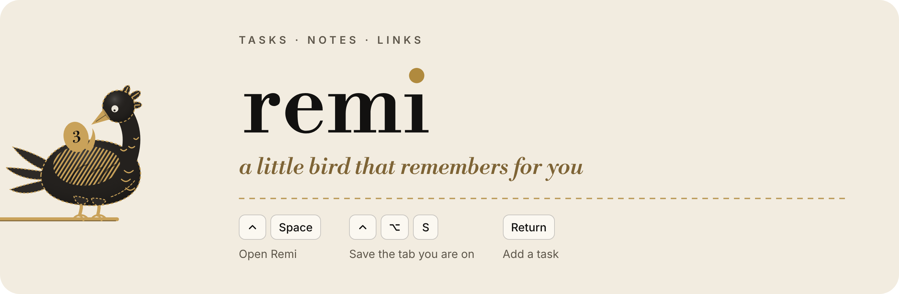
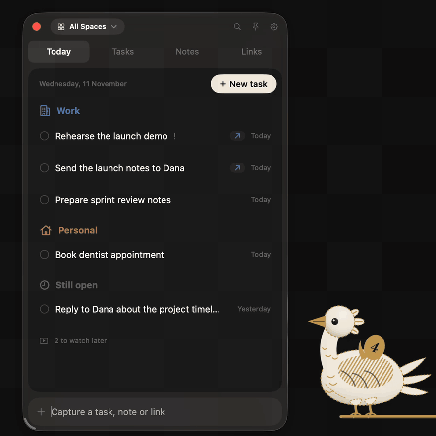
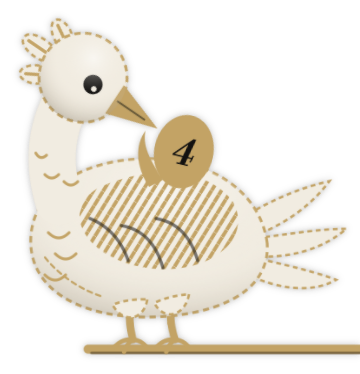
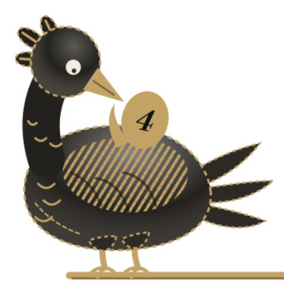
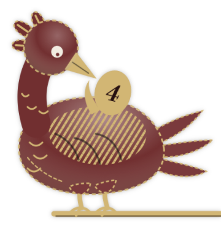
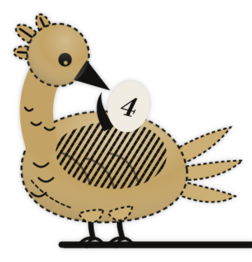
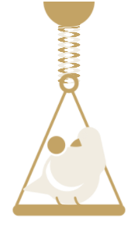
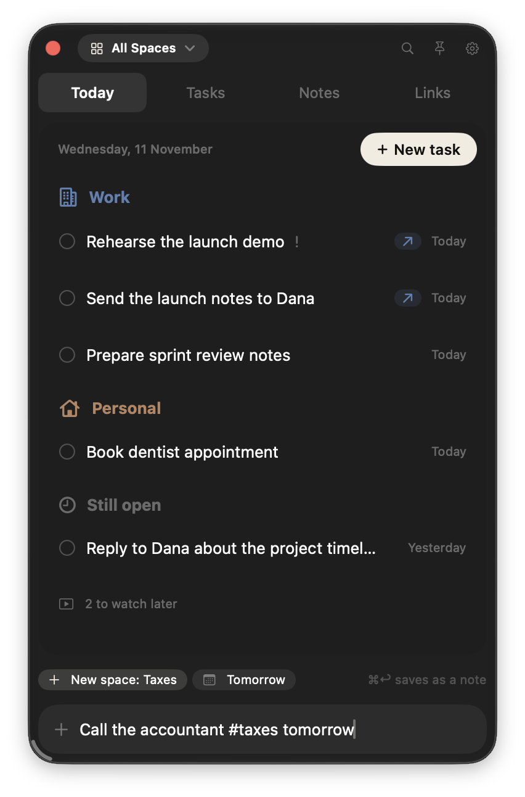

<p align="center">
  <picture>
    <source media="(prefers-color-scheme: dark)" srcset="docs/images/readme-header-dark.png">
    <source media="(prefers-color-scheme: light)" srcset="docs/images/readme-header-light.png">
    
  </picture>
</p>

<p align="center">
  Tasks, notes and links on your Mac, one click or one shortcut away.<br>
  Remi sits on the edge of your screen and holds what you meant to do.
</p>

<p align="center">
  <a href="https://github.com/sharrygold/remi/releases/latest/download/Remi.zip"><strong>Download for Mac</strong></a>
  &nbsp;·&nbsp;
  <a href="#build-from-source">Build from source</a>
</p>

<p align="center">
  
</p>

## What it does

- **Capture in one line.** Type the way you think. Remi works out the Space, the date and whether it repeats.
- **Tasks, notes and links together.** Group them into Spaces like Work and Personal, and search across all of them.
- **Save the tab you are on.** Press ⌃⌥S in Dia, Arc, Chrome, Brave, Edge or Safari, without opening anything.
- **A companion on the edge of your screen.** It wakes when you come near and carries today's count on its egg.
- **Everything stays on your Mac.** No account and nothing to sign up for.

## The idea

Remi comes from Sankofa, an Adinkra symbol of the Akan people of Ghana: a bird looking back at the egg on its back. It is not wrong to go back for what you have forgotten. Remi carries what you meant to do and keeps looking back at it. It is kind about undone things, with no streaks and no guilt.

## The companion

<p>
  
  
  
  
  
</p>

Choose **Perched**, on a gold peg at the side of the screen, or **On the cord**, on a swing at the end of a braided cord with one knot for each task due today. Pick a plumage in **Settings > General**: Ivory, Jet, Oxblood or Brass.

Remi hops when you add a task, pecks at the egg when it catches a link, and shows a check on the egg when everything for today is done.

## Capture in one line



Open Remi with **⌃Space** and type into the bar at the bottom.

| Type | What happens |
|---|---|
| `#work` | Files it in that Space, or makes a new one |
| `today`, `tomorrow`, `fri` | Sets the due date |
| `!` | Marks it important |
| `every monday`, `daily` | Makes it repeat |
| A link on its own | Saves it with its title. Videos go to Watch later |
| Words plus a link | A task that opens that link |
| Return | Saves a task |
| ⌘Return | Saves the same line as a note |

A few lines to try:

```
Call the accountant #taxes tomorrow
Book the venue #work fri !
Stretch every day
```

<br clear="right">

## Install

1. [Download Remi.zip](https://github.com/sharrygold/remi/releases/latest/download/Remi.zip), unzip it and move **Remi.app** to Applications.
2. Open it. macOS says it can't check the app. Close that message.
3. Open **System Settings > Privacy & Security**, scroll down and click **Open Anyway** next to Remi, then confirm.

Remi is free, so it isn't notarized by Apple, which needs a paid developer account. That is why step 3 exists. You only do it once.

Remi needs **macOS 26 or later** and runs on Apple Silicon and Intel Macs.

### First run

A welcome card shows the shortcut, how to type a task and lets you pick a companion. macOS asks for two permissions, each only when it's needed:

- **Notifications**, when you first add a task with a due date. If you use a Focus mode, add Remi under **System Settings > Focus > (your Focus) > Allowed Notifications > Apps**.
- **Browser control**, the first time you press ⌃⌥S. Only that browser's current address and title are read, and only when you ask.

## Keyboard

<details>
<summary>Every shortcut</summary>

| Anywhere | |
|---|---|
| ⌃Space | Open or close Remi (change it in Settings) |
| ⌃⌥S | Save the current browser tab |

| In the panel | |
|---|---|
| ↓ then ↑ ↓ | Move through the list |
| Return | Open a note or link, edit a task's title |
| Space | Tick a task, mark a video watched |
| ⌘O | Run a task's action |
| ⌘P | Pin a note or link, mark a task important |
| ⌘R | Rename |
| ⌘⌫ | Delete (kept in Recently Deleted for 30 days) |
| ⇧⌘[ and ⇧⌘] | Move the item to the previous or next Space |
| ⌘1 to ⌘4 | Today, Tasks, Notes, Links |
| ⌘[ and ⌘] | Previous or next Space |
| ⌘F | Search everything |
| ⌘N | New note |
| ⌘Z | Undo the last change (capture bar empty) |
| ⌘, | Settings |
| Esc | Step back: list, search, then close |

In a note: `# ` heading, `- ` bullet, `[] ` checkbox, `**bold**` or ⌘B, ⇧⌘L checklist line, ⇧⌘U tick.
</details>

## Privacy

Everything stays on your Mac. The only time Remi reaches the internet is to fetch the title and icon of a link you save.

- Your library: `~/Library/Application Support/io.github.sharrygold.remi/Library.store`
- Daily backups, the last 14, in the `Backups` folder next to it. **Settings > Data > Show in Finder** opens it.
- Export writes JSON, which Import reads back, and a Markdown copy.

## Build from source

You need Xcode and [XcodeGen](https://github.com/yonaskolb/XcodeGen). No Apple account is needed.

```sh
brew install xcodegen
git clone https://github.com/sharrygold/remi.git
cd remi
Scripts/install.sh
```

The script builds a Release copy, puts it in `/Applications` and opens it. Run it again to update.

<details>
<summary>Developing</summary>

```sh
xcodegen generate
xcodebuild -project Remi.xcodeproj -scheme Remi -derivedDataPath build/debug build
open build/debug/Build/Products/Debug/Remi.app
xcodebuild -project Remi.xcodeproj -scheme Remi -derivedDataPath build/debug test
```

The `.xcodeproj` is generated from `project.yml`, so don't edit it by hand. Builds are ad hoc signed by default. To sign with your own team, so macOS keeps permissions across rebuilds, see `Config/Signing.xcconfig`. Debug builds use their own data folder.

- `App/Core`: models, store, parser, search, export, backups and the companion's motion. No UI. This is what the unit tests compile.
- `App`: the app around the core. `CompanionSurface`, `PerchedBirdView` and `CordCompanionView` are the companion.
- `docs/brand`: the brand kit.

`--demo-data` runs Remi on sample content kept in memory, which is handy for screenshots. See [CONTRIBUTING.md](CONTRIBUTING.md) for tests and self-tests.
</details>

## Brand

The mark, wordmark, palette and the companion's art are in [`docs/brand`](docs/brand/BRAND_FINAL.md). The wordmark is set in Libre Bodoni and the interface in SF Pro.

## Licence

MIT, see [LICENSE](LICENSE). Libre Bodoni, used for the numerals on the egg, is under the SIL Open Font License (`App/Resources/LibreBodoni-OFL.txt`).
